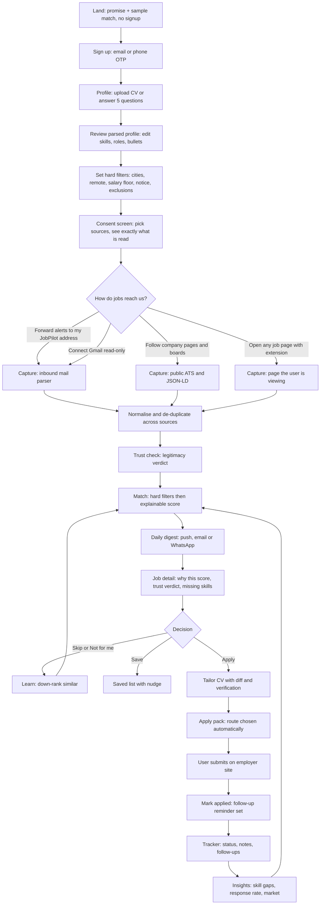
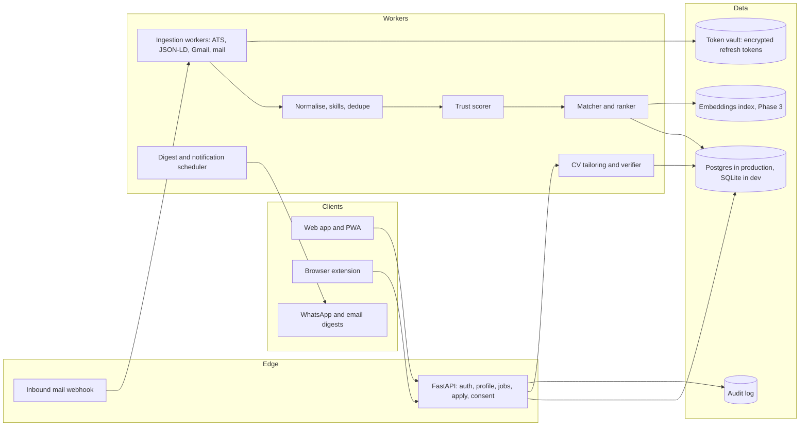
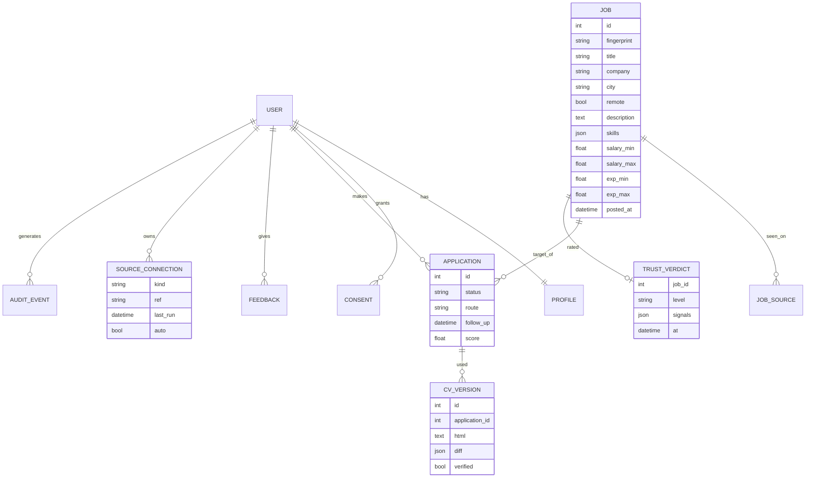
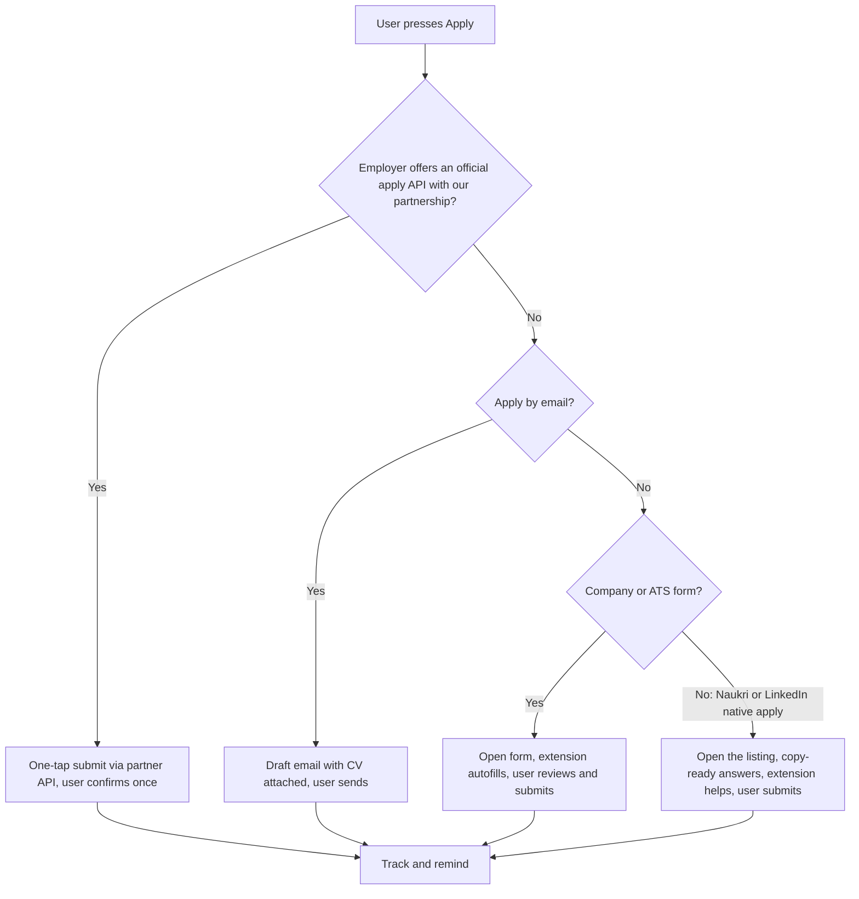
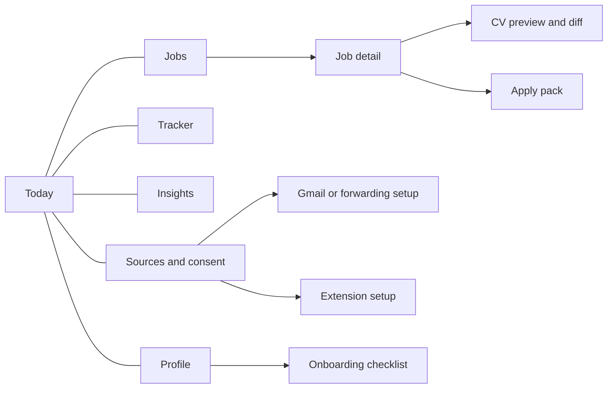

# JobPilot: Complete design flow

Built on `MARKET_ANALYSIS.md`. Diagrams are Mermaid (render on GitHub). Items marked **[built]** exist in `jobpilot/`; **[new]** are designed here and not yet built.

## 1. Product in one page

**Promise:** every portal in one list, scam-checked, a truthful tailored CV for each job, applying in a few taps, all tracked. Never at the cost of the user's Naukri/LinkedIn account.

**Design principles**
1. **Assist, never impersonate.** We act in the user's own session or on their own mail. We never log in to a portal for them and never press the final Submit.
2. **Consent is a feature.** Every data source is a visible, revocable toggle with a plain-language "what we read".
3. **Truth over volume.** CVs only rearrange the user's facts. Matches explain themselves. We don't promise outcomes.
4. **Trust before match.** A scam-checked 70% beats an unchecked 95%.
5. **Mobile-first, low-bandwidth, multilingual.** Most Indian job seekers live on phones.
6. **Calm.** One daily digest, not a feed that begs for attention.

## 2. Users

| Persona | Situation | Needs | Risk |
|---|---|---|---|
| **Aarav, 26, frontend dev, Pune** (beachhead) | Gets alerts from 4 portals, applies to ~10 jobs/week, edits his CV each time | One list, quick tailored CV, autofill, tracking | Won't pay unless it visibly saves hours |
| **Priya, 22, fresher, Lucknow** | Many applications, few replies, afraid of fake offers | Trust verdicts, fee-scam warnings, Hindi UI | Low income; maybe minor/under-18 for internships |
| **Rohit, 34, data lead, Bengaluru** | Passive, selective, 6-month search | Only high-fit roles, salary insight, discretion (his employer must not see) | Privacy-sensitive; hates spam |

## 3. End-to-end journey

## 4. Capture strategy (the supply problem)

The portals are the supply and we cannot touch them directly (M7, M8). So capture is layered by legal safety and data richness.

| Path | How it works | Data richness | Legal/verification posture | Status |
|---|---|---|---|---|
| **A. Forwarding inbox** | User sets a Gmail/Outlook filter that forwards alert mails to `alerts+<token>@in.jobpilot.example`. We parse inbound mail on our own domain. | Titles only | **No Google restricted scope, so no CASA.** User-initiated forwarding. Needs mail-domain setup (SPF/DKIM) and spam handling | **[new] Phase 1, ships before Google verification** |
| **B. Gmail read-only** | OAuth with sender-limited query | Titles only | Restricted scope. Test-user only until CASA passes | **[built]** `/gmail` |
| **C. Public ATS boards** | Greenhouse, Lever, Ashby JSON | Full description | Public APIs | **[built], live untested** |
| **D. More ATS and career pages** | Workday (public JSON), SmartRecruiters, Zoho Recruit, Darwinbox/Keka career pages, schema.org `JobPosting` | Full | Respect robots.txt and each site's terms | JSON-LD **[built]**, rest **[new]** |
| **E. Extension "capture this job"** | User opens a listing on any site; extension reads the visible page and saves it | Full description, even for portals | Acts only on the page the user is viewing, in their session; no automation, no bulk. Grey-area on strict portal terms, so keep to single-page, user-initiated, and review per portal | **[new] Phase 2** |
| **F. Manual** | Paste a link or text; upload `.eml` | Any | Safe | `.eml` **[built]**, paste **[new]** |
| **G. Partnerships** | Official apply/feeds from portals, Indian ATS vendors, college placement cells | Full + apply | Contractual | **[new]** start conversations now |

**Enrichment step (fixes thin alert data):** when a job from an alert has no description, the app offers "Open and capture" (path E) so the user supplies the full text from the page they're viewing; skills and match are then recomputed.

## 5. System architecture

**Trust boundaries:** Gmail tokens only in the vault; the extension gets a separate limited token (autofill profile only) that dies the moment consent is revoked **[built]**; imported email-derived jobs are private to the user **[built]**; email bodies are never persisted **[built]**.

## 6. Data model

Built tables: users, sessions(scope), profiles, consents, audit, jobs, job_owners, applications, feedback, watch_sources, gmail_accounts, gmail_seen, oauth_states. **New:** `trust_verdicts`, `cv_versions`, `inbound_aliases`, `employer_signals`, `notifications`, `payments`.

## 7. Trust layer (new, top priority from market evidence)

Goal: tell the user, honestly and quickly, how much to trust a listing. It never claims certainty and always lets the user report.

| Signal | Direction | Notes |
|---|---|---|
| Found on the employer's own career page or ATS | strong positive | The best single signal |
| Same job on 2+ independent sources | positive | We already merge duplicates; the count is the signal |
| Apply link domain matches company domain | positive | Mismatch is negative |
| Asks for money (processing/registration/training/security/kit fee) | **strong negative** | Pattern match in text and email |
| Contact only via WhatsApp/Telegram/personal mail | negative | Many small Indian firms use WhatsApp, so weight lower than the fee signal |
| Salary far above market for role and seniority | negative | Use our own market data |
| "Offer without interview", "urgent joining", "work from home earn per day" | negative | Phrase list, maintained |
| Description copied across many unrelated companies | negative | Text-similarity clustering |
| Posting older than 45 days | caution | **[built]** |
| User reports (crowd) | strong either way | Needs a report button and abuse protection |

Output levels: **Verified source / Looks fine / Be careful / Likely scam**. UI shows the top 2 reasons in plain words, plus a standing tip ("A real employer never asks you to pay"). Early-career users see warnings more prominently.

## 8. Matching and ranking (evolution)

1. **Now [built]:** hard filters, skills coverage 55, wording similarity 20, role fit 15, experience 10; explainable.
2. **Next:** embedding similarity to catch "Frontend" vs "UI Engineer"; user-feedback weights; salary realism; recency boost; employer-responsiveness signal.
3. **Later:** natural-language search ("remote data analyst jobs in Pune above 12 LPA"), parsed into the same hard filters. This copies a competitor feature, so ship it after the trust layer, not before.

## 9. CV tailoring (kept honest)

Pipeline: select bullets by relevance, reorder skills, rebuild summary from facts, **verify every element against the profile**, show diff **[built]**. Optional LLM rephrasing is allowed only if its output passes the same verifier (no new skills, numbers, employers, titles). Numbers in bullets are locked tokens. ATS-friendly single-column HTML now; true PDF export **[new]**.

## 10. Apply routes

"One-tap" is honest only on R1, which needs partnerships. R2-R4 are "a few taps and a review". The label in the UI says which one applies.

## 11. Screen map (mobile-first)

| Screen | Purpose | Key elements | Empty / error state |
|---|---|---|---|
| **Today** | Daily digest in 60 seconds | Greeting, top 5 matches with trust chip, follow-ups due, one next action | No sources: onboarding checklist; no matches: "loosen your filters" with one-tap suggestions |
| **Jobs** | Browse and filter | Search, min score, "show filtered-out and why", merged-source badge | "Nothing matches your must-haves" plus the single filter blocking most jobs |
| **Job detail** | Decide | Score breakdown, matched/missing skills, trust verdict with reasons, flags, description, Save/Skip/Tailor/Apply, Report listing | Thin alert data: "Open and capture the full text" |
| **CV preview** | Trust the CV | Verified badge, diff list, iframe preview, download | Fails verifier: show which line and fall back to the base CV |
| **Apply pack** | Finish applying | Route label, link/mail button, CV download, extension hint, "Mark as applied" | No link: "Find the apply page" help |
| **Tracker** | Don't lose track | Status, follow-up date, notes, nudges | Empty: explain how apply packs land here |
| **Insights** | Learn | Skill gaps that unlock most jobs, demand, cities, funnel, response rate | Need 10+ jobs: say so |
| **Profile** | Fact bank | Editable roles and bullets, filters, skills | Parse failed (scanned PDF): guided manual entry |
| **Sources and consent** | Control | Toggles, what-we-read text, last run, export, delete, activity log | Unconfigured integration: plain explanation |
| **Onboarding** | First 3 minutes | 3 steps with progress, sample match preview before signup | - |

**Cross-cutting:** language switch (EN/Hindi first, then Tamil, Telugu, Bengali, Marathi); offline-tolerant reading of the daily list; accessible contrast and tap targets; plain wording, no jargon like "OAuth" on user screens.

## 12. Notifications

Daily digest at a user-chosen time; instant alert only for score ≥ 85 and trust "Verified/Looks fine"; follow-up reminders; never more than 1 push/day by default. Channels: web push (PWA), email, WhatsApp Business (explicit opt-in, template approval, per-message cost: price into plan). Quiet hours respected.

## 13. Privacy and compliance design (DPDP-aligned, not legal advice)

- **Notice + consent** per purpose, in the user's language, withdrawable as easily as given **[built, English only]**.
- **Data minimisation:** email bodies not stored; only job fields **[built]**. Retention policy: delete jobs not touched for N days, delete everything N days after account deletion request, logs trimmed.
- **Rights:** access/export **[built]**, correction (profile editing **[built]**), erasure **[built]**, grievance contact **[new]**.
- **Children:** if under-18 users are allowed (internships), verifiable guardian consent is needed; otherwise block with an age gate **[new]**.
- **Security:** hashed passwords, expiring tokens, encrypted Google tokens, SSRF guard **[built]**; rate limits, email/phone verification, password reset, 2FA option, secrets manager, HTTPS-only, backups, breach runbook **[new]**.
- **Consent-manager readiness:** design the consent record as portable (scope, purpose, time, version) so it can be exposed to a registered consent manager later.
- **Google:** Limited Use policy compliance, public privacy policy, CASA when we ship path B publicly.

## 14. Metrics

| Layer | Metric | Why |
|---|---|---|
| Activation | % who finish profile + one source in the first session | Onboarding quality |
| Value | Minutes saved per application (self-reported + modelled), jobs viewed per day | Core promise |
| Quality | "Good match" rate, skip rate by score bucket | Matching accuracy |
| Trust | Scam reports per 1,000 listings, false-positive rate on trust verdict | Safety |
| Outcome | Applications per week, response rate, interviews (self-reported) | Honest outcomes, not promises |
| Revenue | Free-to-paid conversion, 1-month pass vs monthly, churn after "got a job" | Test the pricing hypotheses |
| Compliance | Consent revocations, deletion SLA | DPDP |

## 15. Roadmap with exit criteria

| Phase | Scope | Exit criterion |
|---|---|---|
| **1: Make supply real (3-4 wks)** | Forwarding inbox (A), live-test C, add Workday/SmartRecruiters/Zoho (D), paste-link capture (F), trust layer v1, login hardening | 20 real users each see ≥10 relevant, trust-rated jobs/week from ≥3 sources without manual work |
| **2: Make it habit (4 wks)** | PWA install + web push, digest, Hindi UI, extension capture (E) with enrichment, tracker nudges | Day-7 return ≥ 40% of activated users |
| **3: Make it smarter (4-6 wks)** | Embeddings, NL search, LLM rephrasing behind verifier, interview prep | Skip rate on top-5 matches < 40% |
| **4: Make it a business (ongoing)** | Payments (UPI), pricing tests, WhatsApp, partnerships, CASA, SOC-style security review | Paid conversion measured; Google verified |

## 16. Backlog derived from the market gaps (priority)

| P | Item | Reason |
|---|---|---|
| P0 | Forwarding inbox so users don't wait on Google verification | M12 |
| P0 | Trust layer v1 + report button | M4 |
| P0 | Live-test ATS connectors; add Indian-popular platforms | M9 |
| P0 | Login rate limit, verification, reset | Security |
| P1 | PWA + push + digest; Hindi | India mobile-first |
| P1 | Extension "capture this job" for full descriptions | Alert emails are thin |
| P1 | Notices and consent in Indian languages; age gate | DPDP |
| P2 | Embeddings, NL search | M6 |
| P2 | Payments + pricing experiments | M10 |
| P2 | Employer responsiveness signal | M5 |

## 17. Decisions needed from you
1. **Beachhead:** 1-6 yr IT/data/digital in metros first, or freshers first?
2. **Supply path for launch:** ship the forwarding inbox first (no Google wait), keep Gmail connect for test users?
3. **Mobile:** installable PWA now, native app later - agreed?
4. **Languages:** Hindi first, then which?
5. **Under-18 users:** allow with guardian consent, or 18+ only at launch?
6. **Budget & timing** for CASA (quotes needed) and for a DPDP lawyer review.
